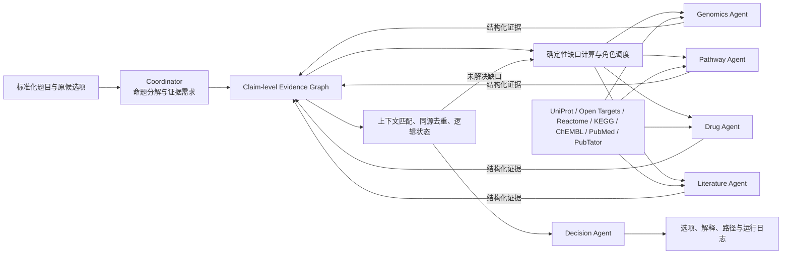

# BioMDT Model 环节

## 方法概览

BioMDT 接收 Data 阶段生成的单条模型输入记录。模型端只读取 `id`、`task_type`、`question`、`options`。答案和解释文件由运行程序及工具执行器隔离，只有评价器在推理完成后读取参考答案。当前方法以 Coordinator 为调度中心，专业 Agent 通过共享命题证据图协作，必要时发送带命题 ID 和缺口的定向消息。



实现位于 `scripts/biomdt/`，统一运行入口为 `scripts/run_biomdt.py`。DeepEvidence 历史版本从固定提交 `b12439eba3c77a9bab652015b17467c1f5bcf9ce` 加载，独立入口为 `scripts/run_deepevidence.py`。实现没有改写作者的 Orchestrator、BFRS、DFRS、图记忆和多轮工具循环。

## Agent 契约

| Agent | 输入 | 可用数据/工具 | 输出与调度作用 |
|---|---|---|---|
| Coordinator | 问题、原始选项、当前图状态、剩余轮数 | 共享图状态 | 原子命题、候选项逻辑、所需证据类型、实体候选；每轮可选择一个优先补证角色 |
| Genomics | 分配的命题、问题上下文、共享实体 | UniProt、Open Targets | 基因/蛋白功能、靶点与疾病关联、稳定实体标识及来源 |
| Pathway | 分配的命题、已规范化基因/蛋白 | KEGG、Reactome | 通路成员、上下游关系、通路编号与来源；通路成员注释按间接机制证据处理 |
| Drug | 分配的药物命题与机制缺口 | ChEMBL molecule、mechanism、target、activity 查询 | 药物-靶点-机制关系；区分体外靶点活性与个体/模型响应 |
| Literature | 命题、目标疾病/模型/干预、实体短查询 | PubMed、PubTator | 观察、实验条件、效应方向、比较对象、PMID；未知或不匹配不转换为反证 |
| Decision | 候选项逻辑状态、证据节点、上下文差异与路径 | 共享图，不访问参考答案 | 合并证据状态、选项预测、证据路径、生物学解释和未解决缺口 |

所有角色共享 `OpenAICompatibleBackend`，也可切换到 `CodexCliBackend`。两个入口使用环境变量 `OPENAI_API_KEY`、`OPENAI_BASE_URL`、`OPENAI_MODEL` 初始化 OpenAI 兼容后端。密钥不会写入运行日志。Codex CLI 当前登录状态由 `codex login status` 检查，未登录时会在模型请求前返回明确错误。

## 命题图数据结构

图由确定性程序维护，LLM 只负责提出命题、上下文与候选证据。实体节点带类型与数据库标识，例如 `Gene:BRCA1`、`UniProt:P38398`、`KEGG:hsa05224`、`ChEMBL:CHEMBL521686`、`PMID:42939506`。Agent 所给实体名称经实体索引映射到已有稳定 ID；未匹配的实体使用类型前缀和规范化标签建临时节点，不伪造数据库 ID。

核心节点有 `Gene`、`Protein`、`Disease`、`Drug`、`Pathway`、`Metabolite`、`BiologicalProcess`、`ExperimentalObservation`、`Literature`、`Claim`、`CompositeClaim` 与 `Evidence`。关系边表达 `encodes`、`member_of`、`participates_in`、`maps_to_option`、`requires`、`supports`、`contradicts` 和 `derived_from`。CompositeClaim 把一组选项原子命题通过 AND、OR、NOT 或 COMPARISON 逻辑映射回原选项。

Evidence 节点保存主体、谓词、客体、命题 ID、来源 ID、来源数据库、原始观察、Agent、事实/推断类别、直接性，以及 intervention、disease、tissue、model、readout、effect direction、comparison、timepoint 等上下文。缺失字段保持空值。相同命题和 PMID 的重复转述不增加独立证据计数。

证据图可表示为有向多重图 $G=(V,E)$。每条证据 $e$ 关联一个原子命题 $c$，并保留来源和上下文。上下文函数 $M(e,c)$ 按疾病、组织、模型、物种、干预、读出、比较对象和时间点比对明确字段。已明确不同的上下文使证据保留在图中但不参与目标命题的支持或反驳集合。

对命题 $c$，令 $S_c$ 和 $R_c$ 分别为上下文适用的支持与反驳证据集合。确定性状态规则为：

```text
if S_c and R_c:       Conflicting
elif S_c:             Supported
elif R_c:             Contradicted
else:                 Missing
```

只有没有适用证据时状态为 Missing。LLM 表示的 `partial_support`、`not_established`、`insufficient_evidence` 和 `context_mismatch` 作为证据节点保留，但不会转成支持或反驳。COMPARISON 选项仅在构成命题均有支持且证据包含比较对象时才支持。多命题 AND 选项要求每个子命题都支持；OR 至少一个子命题支持；NOT 对单个命题状态取反。当前选项归并不使用多数投票。

## 缺口协作算法

初始缺口来自 Missing、Conflicting 和只有间接支持的命题。角色需求由 Coordinator 输出，缺失时回退到 Literature。Conflict 优先由 Literature 检查原始研究及条件，不将数据库字段分歧本身当作生物学冲突。每个角色接收结构化消息，包含发送方、接收方、命题 ID、现有证据 ID、状态、查询要求和剩余轮数。跨角色后续任务的发送方是此前为该命题贡献证据的 Agent；首次任务由 Coordinator 发出。

```text
claims = Coordinator(question, options)
claims = atomicity_audit(claims)
graph = initialize_claim_and_option_nodes(claims)
queue = route(Missing(claims))
for round in 1..budget:
    for role, claim_ids in queue:
        request = make_message(role, claim_ids, graph, remaining_budget)
        records = retrieve_with_cache(role, request)
        evidence = extract(records, claim_ids)
        graph = merge_entities_and_evidence(graph, evidence)
        graph = recompute_context_and_claim_states(graph)
    gaps = derive_gaps(graph)
    queue = Coordinator.select(priority(gaps), remaining_budget)
    stop if queue is empty or graph gains no applicable evidence
answer = Decision(question, options, graph)
```

每条 `(role, claim_id)` 在单次运行中只尝试一次，避免重复搜索同一缺口。查询缓存按数据库、操作和参数键定位，命中时复用完整原始响应和来源编号，Agent 仅收到裁剪后的轻量记录。默认最多两轮协作，可通过 `--max-collaboration-rounds` 调整。Direct LLM 只传问题和选项，不创建工具或图查询。

## 与 DeepEvidence 的区别

DeepEvidence 使用 Orchestrator 根据研究问题触发 BFRS 广度搜索或 DFRS 深度追查，子 Agent 生成研究摘要，共享图记忆保存实体、观察和关系，之后 Orchestrator 再规划或综合。BioMDT 保留这类深度研究基线，同时将状态单位从研究问题和图记忆观察细化到“候选选项的原子命题及其适用证据”。

| 计算环节 | DeepEvidence 历史方法 | BioMDT |
|---|---|---|
| 工作单元 | 研究问题、BFRS/DFRS 搜索目标、图观察 | 原子命题、选项逻辑、上下文条件 |
| 调度触发 | Orchestrator 根据研究进展再次选择 BFS/DFS | 缺少何种命题证据就路由到相应专业角色，并记录消息 |
| 共享状态 | 以实体和观察为主的证据图记忆 | 证据、Claim、CompositeClaim 与 supports/contradicts/requires 边组成的命题级图 |
| 融合 | 依靠 Orchestrator 的研究综合与冲突描述 | 程序按明确上下文排除不适用证据、合并同源记录、计算原子和复合状态 |
| 结论 | 面向研究问题生成综合回答 | 先按 AND/OR/NOT/COMPARISON 规则计算选项状态，再生成可追溯解释 |

这些差别对应可独立实现和消融的计算模块。当前开发实现已具有命题图、上下文状态、角色路由、来源校验和官方输入输出接口；策略质量仍需在后续固定预算的正式评测中比较。

## 运行入口

```bash
export OPENAI_API_KEY="<your-key>"
export OPENAI_BASE_URL="https://api.example.com"
export OPENAI_MODEL="your-model"

python scripts/run_biomdt.py --method biomdt --item-id preclinical_research_1
python scripts/run_biomdt.py --method direct --item-id preclinical_research_1
python scripts/run_deepevidence.py --item-id preclinical_research_1 --backend openai-compatible
python scripts/collect_predictions.py --method biomdt --runs-dir results/biomdt/runs --output results/biomdt/biomdt_predictions.jsonl
python scripts/evaluate_deepevidence.py --item-id preclinical_research_1 --predictions results/biomdt/biomdt_predictions.jsonl --output results/biomdt/pilot_scores.json
```

默认运行器只接受明确指定的 `--item-id` 或已登记的 `--pilot-only`，不会自动遍历 75 题。每题记录写入 `results/<method>/runs/`，主预测文件为 `{id, prediction}` JSONL，可直接交给 Data 阶段的作者评分器。

## 开发验证

所有试跑仅使用已登记的 `preclinical_research_1`，该题已在早期 DeepEvidence 调试中暴露。不得将此分数视为正式性能结果。三种路径均通过官方 Exact Match 评分入口，单题开发准确率均为 0，分母为 1，不能用于方法比较。

| 路径 | 实际调用与工具 | Token 用量 | Pilot 输出 | 官方 Exact Match |
|---|---|---:|---|---:|
| DeepEvidence 历史基线 | 9 次模型调用；7 次工具调用；执行 Orchestrator → BFRS → PubMed 查询 → 图记忆写入/检索 → 最终综合 | 输入 75,014；输出 1,546 | 无选项；图有 2 个实体和 1 条 PMID 证据关系，解释指出 HNSCC 专属机制未被已检索记录证实 | 0/1 |
| Direct LLM | 1 次模型调用；0 次工具调用 | 输入 4,677；输出 453 | 选择 A、B、C、D、E | 0/1 |
| BioMDT | 4 次模型调用；4 次 PubMed/PubTator 请求；记录了 11 个原子命题 | 输入 23,737；输出 6,281 | 无选项；本次保存的运行结果没有成功关联证据节点 | 0/1 |

BioMDT 的 API 响应格式曾以 `claim_evidence` 返回，而接口同时还会使用 `claims` 或 `results` 分组。解析器现覆盖这三种结构，并为 `source_ids` 展开 PMID、将部分支持和明确上下文不适配保留为非支持证据；单元测试涵盖这些实际观察到的返回形状。当前试跑日志是在兼容该返回结构前写入，不能代表修正后的证据图输出。未因该日志重新调用模型，下一阶段运行应先用已暴露题做一次端到端确认，再开始 Baseline 实现比较。

两条此前 Codex CLI DeepEvidence 试跑合计约 223,172 和 230,192 输入 Token。历史 Agent 会将累积 LangChain 消息、重复系统提示和工具 schema 发入多轮调用，并把文献摘要或工具返回继续写入历史。本地 API 适配的 DeepEvidence pilot 为 75,014 输入 Token，BioMDT 当次为 23,737 输入 Token；这些单题数字受模型、返回结构、缓存状态和 Agent 决策影响，只作为开销记录。OpenAI 兼容接口返回模型 ID `gpt-6-luna`，每次调用记录输入/输出 Token、工具数量和耗时；不需要 Codex CLI 登录。

## 已知限制

- BioMDT pilot 的实际解析响应格式在最新实现前完成，因此保存的运行记录没有证据节点。当前适配器对捕获的返回字段有回归测试，重新执行端到端 pilot 是使用该版本前的必要步骤。
- 该 pilot 的 Coordinator 将实体数组返回为空，Literature 角色被选中而 Genomics、Pathway、Drug 未激活。其余角色的工具映射和调用契约有离线测试，真实请求还需在后续开发验证中覆盖。
- BioMDT 与 Direct 的单题 exact match 都为 0；DeepEvidence 的单题 exact match 也为 0。当前模型参数和单一试跑不能说明方法优劣。
- 历史 DeepEvidence 本地 Docker 镜像不存在，源码回退本地 Python 执行后工作流完成。运行使用 `rank-bm25` 和项目全局 LangChain 依赖环境。
- 当前 `~/.local/bin/codex` 状态为未登录。本阶段三条方法路径使用同一 OpenAI 兼容后端，不报告为 Codex CLI 会话复用。
